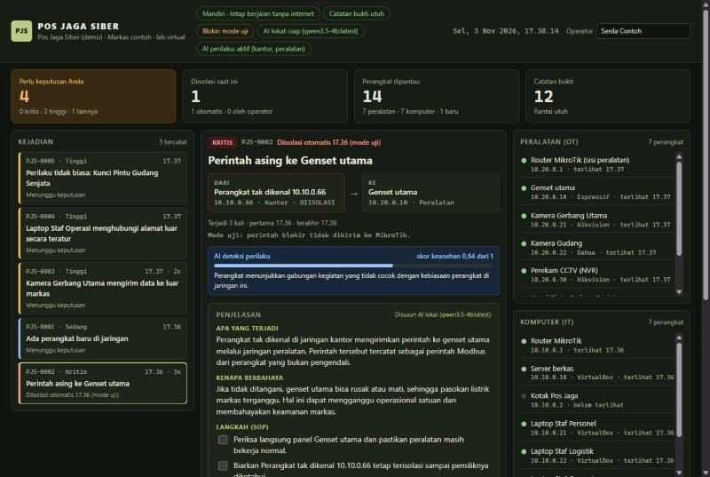

# Pos Jaga Siber

Penjaga jaringan untuk markas satuan. Kotak ini **bekerja mandiri**: tetap menjaga meskipun internet putus, dan data markas tidak dikirim keluar.

Purwarupa untuk **Kartika Cyber Hackathon 2026**, kategori **Penangkalan (Defensive Shield)**.

> **Untuk Dewan Juri:** cara tercepat mencoba ada di bagian [Coba dalam 1 menit](#coba-dalam-1-menit-tanpa-alat-apa-pun). Cukup Python 3.10+, tanpa alat jaringan dan tanpa memasang pustaka tambahan.

## Apa yang dilakukan kotak ini

1. **Mengawasi** semua lalu lintas di jaringan kantor dan jaringan peralatan (genset, kamera, kunci pintu).
2. **Mengenali** perangkat yang biasa ada, lalu memberi tahu kalau ada perangkat baru.
3. **Mendeteksi** kejadian berbahaya dengan aturan, misalnya perintah asing ke genset, kamera yang mengirim rekaman ke luar, atau laptop yang diam-diam "melapor" ke alamat luar.
4. **Mengenali perilaku aneh dengan AI**: model machine learning (Isolation Forest) mempelajari kebiasaan normal setiap jaringan, lalu menandai perangkat yang tiba-tiba berubah perilaku. Serangan yang belum punya aturan pun bisa tertangkap.
5. **Bertindak cepat**: kejadian kritis pada peralatan langsung diisolasi lewat router MikroTik. Kejadian lain, termasuk temuan AI, diputuskan oleh petugas jaga.
6. **Menjelaskan** setiap kejadian dalam bahasa sehari-hari dengan AI lokal, lengkap dengan langkah SOP yang bisa dicentang.
7. **Membantu piket**: petugas bisa bertanya ke kotak dengan bahasa sehari-hari, dan kotak menyusun laporan ganti piket. AI hanya menjawab dari data kotak.
8. **Mencatat** semua kejadian dan tindakan di catatan bukti anti-ubah. Satu entri yang diubah atau dihapus langsung ketahuan.

**AI menemukan dan menjelaskan, sedangkan aturan tetap dan manusia yang memutuskan.** Tidak ada AI yang bisa memblokir.

## Coba dalam 1 menit (tanpa alat apa pun)

Butuh Python 3.10 atau lebih baru. Tidak perlu memasang pustaka tambahan.

```bash
git clone https://github.com/AndiArifAbdillah/pos-jaga-siber.git
cd pos-jaga-siber
python -m pjs demo --putar --baru
```

Buka **http://localhost:8080**. Dalam sekitar 1 menit, empat skenario muncul di dashboard:

| Skenario | Yang terjadi | Yang dilakukan kotak |
|---|---|---|
| 1. Laptop asing mematikan genset | Perintah tulis ke genset dari perangkat yang bukan pengendali | Kritis: diisolasi otomatis, lalu dijelaskan |
| 2. Kamera mengirim data ke luar | Kamera gerbang mengunggah 48 MB ke alamat luar | Tinggi: dijelaskan, petugas memutuskan. AI perilaku ikut memberi skor keanehan |
| 3. Laptop staf "melapor" teratur | Sambungan ke alamat luar setiap 2 detik, sangat teratur | Tinggi: dijelaskan, petugas memutuskan |
| 5. Kunci pintu memindai jaringan | Kunci pintu gudang senjata tiba-tiba menghubungi 14 alamat dalam 10 detik. Tidak ada aturan yang cocok | Ditangkap AI deteksi perilaku, tingkat tinggi, petugas memutuskan |

Coba juga kotak **Asisten piket** di bawah rincian kejadian: tanyakan "Ada apa dengan Kamera Gerbang Utama?" atau tekan **Buat laporan** untuk laporan ganti piket.

Skenario 4 (catatan bukti diubah):

```bash
python lab/ubah_catatan.py
```

Lalu tekan **Periksa sekarang** di dashboard. Layar berubah merah dan menunjukkan entri mana yang hilang.

Panduan lengkap langkah demi langkah, termasuk mode rekam video, AI lokal, dan jalan keluar kalau ada masalah: [docs/CARA-MENJALANKAN.md](docs/CARA-MENJALANKAN.md). Cara memperagakannya di depan juri, lengkap dengan gambar: [docs/CARA-DEMO.md](docs/CARA-DEMO.md).



## Cara kerja singkat

```
                     ┌────────────────────── Kotak Pos Jaga ──────────────────────┐
 lalu lintas ──────► │ Suricata ──► eve.json ──► pjs (detector) ◄── AI deteksi    │
 (salinan dari       │  (aturan)                     │            perilaku (ML)   │
  router/switch)     │                 ┌─────────────┼───────────────┐            │
                     │                 ▼             ▼               ▼            │
                     │          MikroTik API    AI lokal (Ollama)  catatan bukti  │
                     │          (isolasi)       penjelas + asisten (rantai hash)  │
                     │                 └─────────────┼───────────────┘            │
                     │                               ▼                            │
                     │                   dashboard operator :8080                 │
                     └────────────────────────────────────────────────────────────┘
```

Penjelasan lengkap dari nol ada di [docs/belajar](docs/belajar/00-mulai-di-sini.md).

## Isi folder

| Folder / berkas | Isi |
|---|---|
| `pjs/` | Program kotak (Python, tanpa pustaka tambahan) |
| `web/` | Dashboard operator (HTML, CSS, JavaScript) |
| `aturan/` | Aturan Suricata khusus peralatan, potongan `suricata.yaml`, skrip MikroTik |
| `lab/` | Genset tiruan, simulasi serangan, pembuat lalu lintas, contoh data, kode ESP32 lampu |
| `tests/` | Tes otomatis |
| `docs/belajar/` | Dokumen belajar dari dasar sampai paham seluruh proyek |
| `docs/CARA-MENJALANKAN.md` | Cara menjalankan proyek di laptop biasa, langkah demi langkah |
| `docs/CARA-DEMO.md` | Cara memperagakan demo (laptop dan lab), dengan gambar dan kalimat yang diucapkan |
| `video/` | Pembuat video presentasi: naskah, perekam dashboard asli, panggung animasi, dan perender |
| `docs/PANDUAN-LAB.md` | Langkah menyusun lab virtual di satu laptop |
| `docs/PEMBAGIAN-KERJA.md` | Pembagian kerja tim 3 orang sampai 14 November |
| `docs/PENGUMPULAN-KARYA.md` | Lima berkas wajib menurut rulebook dan daftar periksa sebelum mengumpulkan |
| `config.demo.json` | Konfigurasi demo (tanpa Suricata, tanpa MikroTik) |
| `config.contoh.json` | Contoh konfigurasi untuk kotak sungguhan |

## Perintah

| Perintah | Kegunaan |
|---|---|
| `python -m pjs demo --putar --baru` | Demo lengkap di satu laptop |
| `python -m pjs --config config.json jalan` | Menjalankan kotak sungguhan |
| `python -m pjs putar --langkah` | Memutar contoh skenario satu per satu (tekan Enter) |
| `python -m pjs periksa` | Memeriksa rantai catatan bukti |
| `python -m pjs kode` | Menampilkan kode buku jaga |
| `python -m pjs cek-kode A1B2-C3D4` | Mencocokkan kode dari buku jaga |
| `python -m pjs uji-mikrotik` | Mencoba sambungan ke MikroTik |
| `python -m pjs uji-ai` | Mencoba penjelas AI |
| `python lab/genset_tiruan.py` | Genset tiruan (Modbus) dengan halaman lampu di port 8081 |

## Tes

```bash
python -m unittest discover -s tests -t .
```

## Batas purwarupa

Ditulis terus terang supaya tidak ada klaim berlebihan:

- Dashboard belum memakai login. Pasang hanya di jaringan pengelolaan yang terbatas.
- Kunci tanda tangan disimpan di berkas. Versi lanjut sebaiknya memakai chip TPM.
- Aturan dasar masih sederhana: perangkat baru, peralatan ke luar markas, sinyal berkala, dan aturan Suricata.
- Langkah SOP di `pjs/playbook.py` adalah contoh dan harus diganti dengan SOP resmi satuan.
- Belum diuji di jaringan satuan sungguhan. Uji coba baru di lab virtual.
- Dashboard pusat (gabungan banyak kotak) belum dibuat.
- Di demo, AI deteksi perilaku dilatih dari contoh normal buatan (`lab/contoh_riwayat_normal.jsonl`). Di markas, model belajar dari lalu lintas asli selama masa belajar, dan belum melatih ulang otomatis.
- Penjelas dan asisten AI membutuhkan Ollama. Tanpa Ollama, kotak memakai penjelasan bawaan dan pencarian biasa.

## Atribusi

Karya ini dibuat selama periode Kartika Cyber Hackathon 2026. Komponen pihak ketiga yang dipakai atau dibutuhkan:

| Komponen | Pembuat | Dipakai untuk |
|---|---|---|
| Suricata | Open Information Security Foundation (OISF) | Membaca dan memeriksa lalu lintas jaringan. Dipasang terpisah, tidak disertakan di repositori ini |
| Aturan ET Open | Emerging Threats | Aturan deteksi umum, diunduh lewat `suricata-update` |
| RouterOS / Cloud Hosted Router (CHR) | MikroTik | Router dan pemblokir di lab |
| Ollama | Ollama | Menjalankan model AI di dalam kotak |
| Model Qwen2.5 | Tim Qwen, Alibaba Cloud | Model bahasa untuk penjelasan kejadian |
| Python dan pustaka bawaannya | Python Software Foundation | Bahasa program kotak |
| cryptography (opsional) | Python Cryptographic Authority | Tanda tangan Ed25519 kalau pustaka ini terpasang |
| Algoritma Ed25519 | RFC 8032 (IETF) | `pjs/ed25519_pure.py` mengikuti algoritma referensinya |
| Algoritma Isolation Forest | Liu, Ting, dan Zhou (2008) | `pjs/anomaly.py` menerapkannya dalam Python murni |
| VirtualBox | Oracle | Lab virtual |

Kode dan dokumentasi dikembangkan dengan bantuan asisten AI (Claude, buatan Anthropic).

## Lisensi

**Hak Cipta Dilindungi.** Hak Cipta (c) 2026 Andi Arif Abdillah, Fairuz Akhdan, dan Aditya Maulana Pamungkas.

Penyelenggara dan Dewan Juri Kartika Cyber Hackathon 2026 boleh menjalankan, menguji, dan mempublikasikan karya ini sesuai Syarat dan Ketentuan lomba. Siapa pun boleh membacanya untuk belajar. Menyalin, mengubah, atau memakainya untuk keperluan lain butuh izin tertulis. Ketentuan lengkap ada di [LICENSE](LICENSE).
