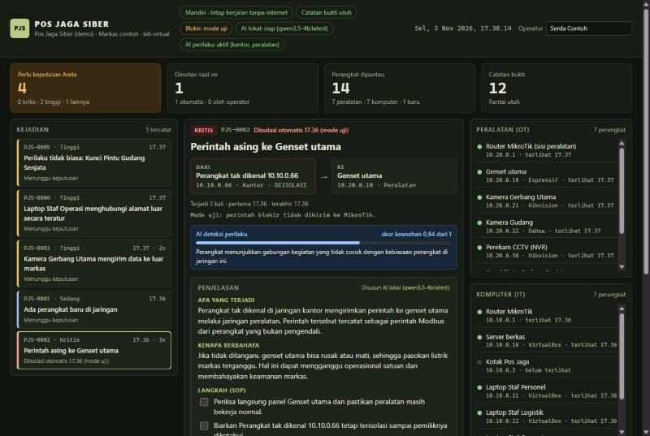
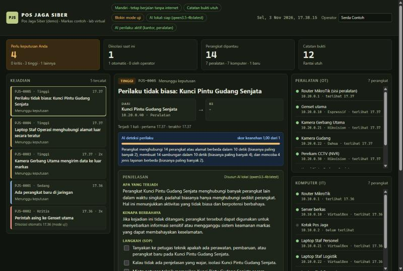
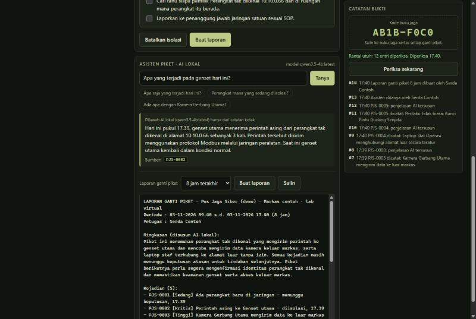
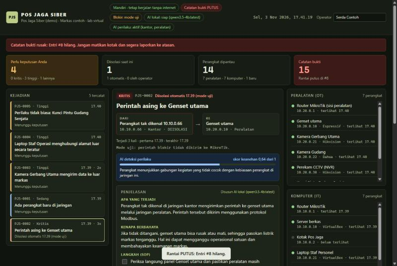

# Cara mendemokan Pos Jaga Siber

Panduan ini menjelaskan cara **memperagakan** Pos Jaga Siber di depan orang lain: saat latihan, merekam video, atau presentasi final. Untuk sekadar menjalankan program, lihat [CARA-MENJALANKAN.md](CARA-MENJALANKAN.md).

| Jenis demo | Alat | Dipakai untuk |
|---|---|---|
| **A. Demo di satu laptop** | Laptop saja | Latihan, menjelaskan ke teman tim, video cadangan, cadangan saat final kalau lab bermasalah |
| **B. Demo di lab** | Laptop dengan lab VirtualBox (MikroTik, Suricata, genset tiruan) | Video utama dan presentasi final, karena serangannya benar-benar dijalankan |

Gambar di panduan ini diambil dari demo sungguhan dengan model AI `qwen3.5-4b`.

---

## A. Demo di satu laptop

### A1. Persiapan (sekali saja)

1. **Python 3.10 atau lebih baru** dan folder proyek. Lihat [CARA-MENJALANKAN.md](CARA-MENJALANKAN.md) bagian 1–2.
2. **Ollama dengan satu model AI** (supaya penjelasan dan asisten memakai AI). Cek model yang sudah ada:

   ```bash
   ollama list
   ```

   Kalau belum ada model sama sekali, unduh satu (butuh internet, sekali saja):

   ```bash
   ollama pull qwen2.5:1.5b
   ```

3. **Cek kotak bisa memakai model itu.** Ganti `qwen3.5-4b:latest` dengan nama model dari `ollama list`:

   ```bash
   python -m pjs --config config.demo.json uji-ai --model qwen3.5-4b:latest
   ```

   Hasil yang benar menampilkan "Apa" dan "Kenapa" dalam bahasa Indonesia.

Tanpa Ollama pun demo tetap jalan: penjelasan memakai teks bawaan dan asisten memakai pencarian biasa. **AI deteksi perilaku tetap aktif**, karena ia tidak memakai Ollama.

### A2. Sebelum mulai (setiap kali demo)

- [ ] Tutup demo lama yang mungkin masih berjalan (tekan **Ctrl+C** di terminalnya).
- [ ] Matikan notifikasi Windows (Focus / Jangan Ganggu), supaya tidak muncul di layar.
- [ ] Siapkan dua jendela terminal di folder proyek dan satu jendela browser.
- [ ] Perbesar tampilan browser kalau ditampilkan di proyektor (**Ctrl + +**).

### A3. Menjalankan

**Cara 1: otomatis.** Semua skenario diputar sendiri dalam sekitar 1 menit. Cocok untuk latihan.

```bash
python -m pjs demo --putar --baru --model qwen3.5-4b:latest
```

**Cara 2: satu per satu (disarankan saat presentasi).** Kamu bisa bercerita dulu sebelum setiap serangan.

Terminal 1, nyalakan kotak tanpa memutar skenario:

```bash
python -m pjs demo --baru --model qwen3.5-4b:latest
```

Terminal 2, putar skenario. Perintah ini berhenti dan menunggu **Enter** sebelum setiap skenario:

```bash
python -m pjs --config config.demo.json putar --langkah
```

Lalu buka **http://localhost:8080** di browser. Tunggu sampai tanda di kanan atas menunjukkan:

- **AI lokal: siap (nama model)**. Saat baru menyala, tulisannya "memuat model". Permintaan pertama ke model butuh waktu lebih lama, jadi tunggu sampai "siap".
- **AI perilaku: aktif (kantor, peralatan)**.

Kalau tidak memakai Ollama, hapus bagian `--model ...`.

### A4. Urutan peragaan

Kalimat bercetak miring adalah contoh yang bisa diucapkan. Naskah lengkap dan jawaban untuk pertanyaan juri ada di [belajar/11](belajar/11-demo-dan-tanya-jawab.md).

#### Langkah 1 · Markas dalam keadaan normal

Tekan Enter untuk bab "Pemanasan" (kalau memakai cara 2). Daftar perangkat terisi, belum ada kejadian.

*"Ini layar petugas jaga. Kotak mengawasi jaringan kantor dan jaringan peralatan: genset, kamera, dan kunci pintu. Sekarang semuanya normal."*

#### Langkah 2 · Skenario 1: laptop asing mematikan genset

Tekan Enter untuk skenario 1. Muncul "Ada perangkat baru di jaringan", lalu **"Perintah asing ke Genset utama"** dengan tingkat **KRITIS** dan status **Diisolasi otomatis**. Klik kejadian itu.



Yang ditunjukkan:

- **Kotak "Diisolasi saat ini" = 1.** Kotak bertindak tanpa menunggu petugas.
- **Kartu DARI → KE:** laptop tak dikenal ke Genset utama.
- **Penjelasan "Disusun AI lokal":** apa yang terjadi dan kenapa berbahaya, dalam bahasa sederhana.
- **Langkah SOP:** centang langkah pertama, lalu tunjukkan entri baru di panel Catatan bukti.

*"Untuk genset, satu detik terlambat bisa berarti listrik padam. Karena itu kejadian kritis pada peralatan diisolasi otomatis, lalu dijelaskan ke petugas."*

#### Langkah 3 · Skenario 2 dan 3: petugas yang memutuskan

Tekan Enter untuk skenario 2 dan 3. Muncul "Kamera Gerbang Utama mengirim data ke luar markas" dan "Laptop Staf Operasi menghubungi alamat luar secara teratur", keduanya **menunggu keputusan**. Klik kejadian kamera: ada kotak biru **AI deteksi perilaku** dengan skor keanehan, sebagai penguat.

*"Kejadian yang tidak kritis tidak diblokir otomatis. Keputusan tetap di tangan petugas, dengan satu tombol: Isolasi perangkat atau Bukan ancaman."*

Boleh menekan **Isolasi perangkat** pada kejadian kamera untuk menunjukkan tombolnya bekerja.

#### Langkah 4 · Skenario 5: serangan tanpa aturan, ditangkap AI

Tekan Enter untuk skenario 5. Tunggu sekitar 10 detik (AI menilai per rentang 10 detik). Muncul **"Perilaku tidak biasa: Kunci Pintu Gudang Senjata"**. Klik kejadian itu.



Yang ditunjukkan:

- **Kotak biru AI deteksi perilaku:** skor keanehan 1,00 dan alasannya, misalnya "menghubungi 14 perangkat atau alamat berbeda dalam 10 detik (biasanya paling banyak 2)".
- **Statusnya menunggu keputusan:** AI tidak memblokir sendiri.

*"Tidak ada aturan untuk serangan ini. AI deteksi perilaku mempelajari kebiasaan normal setiap jaringan dengan machine learning. Ia tidak tahu nama serangannya, tetapi tahu ini tidak biasa, dan menjelaskan alasannya."*

Ini bagian **terpenting** untuk tema lomba (pemanfaatan AI).

#### Langkah 5 · Asisten piket

Gulir ke kotak **Asisten piket · AI lokal** di bawah rincian kejadian. Ketik pertanyaan, misalnya *"Apa yang terjadi pada genset hari ini?"*, lalu tekan **Tanya**. Setelah itu tekan **Buat laporan** di bagian laporan ganti piket.



Yang ditunjukkan:

- **Jawaban asisten** menyebut nomor kejadian sumbernya (klik nomornya untuk membuka kejadian itu).
- **Pertanyaan yang tidak ada datanya** (misalnya "Berapa suhu ruang server?") dijawab "Saya tidak menemukan datanya di catatan kotak." AI tidak mengarang.
- **Laporan ganti piket:** ringkasan disusun AI, daftar kejadian diambil langsung dari data. Tekan **Salin** untuk ditempel ke buku jaga.

#### Langkah 6 · Skenario 4: catatan bukti diubah

Di terminal lain di folder proyek (kalau memakai cara 2, pakai terminal 2 setelah pemutar skenario selesai), jalankan:

```bash
python lab/ubah_catatan.py
```

Kembali ke dashboard, gulir ke atas, lalu tekan **Periksa sekarang** di panel Catatan bukti.



*"Misalkan ada yang menghapus jejak. Satu entri saja dihapus, kotak langsung tahu entri nomor berapa yang hilang. Kode di buku jaga kertas juga tidak bisa dihapus dari jauh."*

Skenario ini merusak catatan demo. Lakukan **paling akhir**, dan mulai ulang dengan `--baru` untuk demo berikutnya.

#### Langkah 7 · (Opsional) Laporan siap cetak

Klik kejadian genset, lalu tekan **Buat laporan** di kartunya. Terbuka halaman laporan resmi dengan jejak catatan bukti dan kolom tanda tangan.

### A5. Mengulang dan mematikan

- **Mematikan:** tekan **Ctrl+C** di terminal 1.
- **Mengulang dari awal:** jalankan lagi perintah demo dengan `--baru`. Semua data demo lama dihapus.

---

## B. Demo di lab (untuk video dan final)

Lab disusun mengikuti [PANDUAN-LAB.md](PANDUAN-LAB.md). Bedanya dengan demo laptop: serangannya **benar-benar dijalankan**, dan pemblokiran **benar-benar terjadi** di MikroTik.

### B1. Susunan layar

Bagi layar menjadi empat jendela supaya penonton melihat sebab dan akibat sekaligus:

```
┌──────────────────────────────┬──────────────────────────────┐
│ Dashboard Pos Jaga           │ Lampu genset                 │
│ (browser, http://10.10.0.2:  │ (ESP32 sungguhan, atau       │
│  8080)                       │  halaman lampu port 8081)    │
├──────────────────────────────┼──────────────────────────────┤
│ Terminal penyerang           │ Terminal MikroTik            │
│ (VM klien)                   │ (/ip firewall address-list)  │
└──────────────────────────────┴──────────────────────────────┘
```

### B2. Sebelum mulai

- [ ] Semua VM menyala, `sudo suricata -T` lulus, `python3 -m pjs uji-mikrotik` berhasil.
- [ ] Daftar `pjs-karantina` di MikroTik **kosong**.
- [ ] Genset tiruan menyala (lampu menyala).
- [ ] Data kotak bersih: hentikan kotak, kosongkan folder data, jalankan lagi.
- [ ] AI deteksi perilaku sudah "aktif" (masa belajar selesai, lihat PANDUAN-LAB bagian 8b).
- [ ] Dashboard sudah menunjukkan "AI lokal: siap".

### B3. Urutan

| No | Di VM | Perintah | Yang ditunjukkan |
|---|---|---|---|
| 1 | klien | `python3 lab/serangan_genset.py --target 10.20.0.10 --dari 10.10.0.66 --ulang 5` | Lampu, dashboard "diisolasi otomatis", kiriman berikutnya **GAGAL** di terminal penyerang, alamat muncul di daftar `pjs-karantina` |
| 2 | genset | `python3 lab/kirim_berkala.py --tujuan 203.0.113.50 --dari 10.20.0.21 --ukuran 500000 --jumlah 3 --jeda 5` | Kejadian kamera, petugas menekan Isolasi |
| 3 | klien | `python3 lab/kirim_berkala.py --tujuan 203.0.113.77 --dari 10.10.0.23 --jeda 10 --jumlah 8` | Kejadian sinyal berkala |
| 5 | genset | `python3 lab/pindai_tiruan.py --jaringan 10.20.0 --dari 10.20.0.40` | Kejadian AI deteksi perilaku dengan skor dan alasan |
| - | dashboard | Tanya asisten, buat laporan piket | Jawaban dengan sumber, laporan siap salin |
| 4 | kotak | `sudo python3 lab/ubah_catatan.py /var/lib/pjs/bukti.jsonl`, lalu **Periksa sekarang** | Layar merah |
| - | VirtualBox | Putuskan kartu NAT kotak | Kotak tetap bekerja tanpa internet (bukti "mandiri") |

### B4. Rekam layar untuk video

- **Alat:** Xbox Game Bar bawaan Windows (**Win + Alt + R** untuk mulai dan berhenti merekam), atau OBS Studio (gratis, bisa merekam seluruh layar).
- **Resolusi:** minimal 1280 × 720, perbesar tampilan browser supaya tulisan terbaca.
- **Durasi:** maksimal **10 menit** (rulebook). Alur menit per menit ada di [PENGUMPULAN-KARYA.md](PENGUMPULAN-KARYA.md).
- **Cadangan:** rekam juga demo laptop (bagian A). Kalau lab bermasalah saat final, rekaman ini bisa diputar.

---

## C. Kalau ada masalah saat demo

| Gejala | Jalan keluar |
|---|---|
| Browser: "localhost refused to connect" | Kotak belum berjalan atau terminalnya tertutup. Jalankan lagi perintah demo, biarkan terminalnya terbuka |
| "AI lokal: model … belum diunduh" | Pakai `--model` dengan nama dari `ollama list`, atau unduh modelnya dengan `ollama pull` |
| "AI lokal: memuat model" lama sekali | Model sedang dimuat ke memori (bisa 40 detik lebih saat pertama). Tunggu sampai "siap" sebelum memulai |
| Penjelasan masih "Penjelasan bawaan" | AI sedang menyusun (tulisan "AI sedang menyusun penjelasan...") atau AI belum tersambung. Demo tetap bisa dilanjutkan |
| Kejadian "Perilaku tidak biasa" belum muncul | Tunggu sekitar 10 detik setelah skenario 5 |
| Layar merah sebelum skenario 4 | Skenario 4 pernah dijalankan pada data ini. Mulai ulang dengan `--baru` |
| Port 8080 sudah dipakai | Tambahkan `--port 8090`, lalu buka http://localhost:8090 |
| Asisten lama menjawab | Jawaban pertama setelah kotak menyala bisa lebih lama. Ajukan satu pertanyaan saat latihan sebelum tampil |
